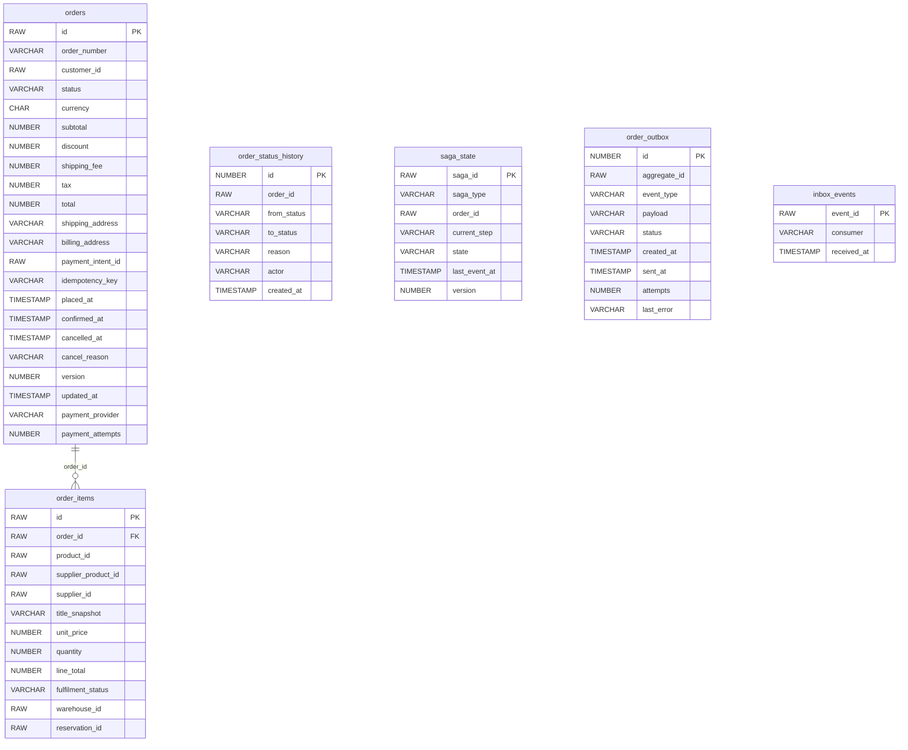
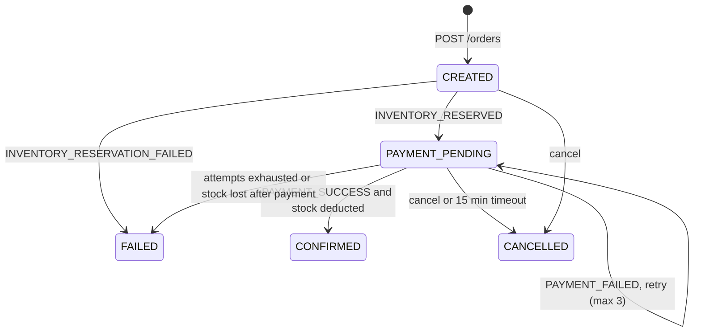

# ShopTrail Order Service

Checkout and order lifecycle for ShopTrail. It orchestrates the order saga: reserve stock, take payment, confirm, or compensate.

Part of **ShopTrail**, a multi-seller marketplace. Full system reference: [`marketplace_tdd.md`](https://github.com/RaghuMHulkoti/shoptrail/blob/main/docs/marketplace_tdd.md).

| | |
|---|---|
| Live | https://order-service-nf43.onrender.com |
| Swagger UI | https://order-service-nf43.onrender.com/swagger-ui.html |
| Health | https://order-service-nf43.onrender.com/actuator/health |
| Local port | `8086` |
| Database | Oracle Autonomous DB, schema `ORDERS` (Flyway) |
| Stack | Java 25, Spring Boot 4.1, Spring Data JPA, Flyway, Spring Kafka |

## Responsibilities

- Turn the customer's cart into an order (idempotent).
- Drive the saga: `ORDER_CREATED` to inventory, `PAYMENT_REQUESTED` to payment, confirm on `PAYMENT_SUCCESS`, compensate on failures.
- Payment retries (up to 3 attempts, a new intent each time) and a 15-minute payment timeout.
- Order history and status for the customer.
- Serves the **ShopTrail Orders** test console at `/console.html` (sign-in required). It exists only to exercise the checkout flow from a browser; a dedicated frontend has not been built yet.

## How it fits

- REST out: cart (cart snapshot, remove ordered lines), inventory (deduct, release), payment (confirm, status, refund).
- Kafka: produces `domain.order.events`; consumes `domain.inventory.events` and `domain.payment.events`.
- The customer is identified by the `X-User-Id` header (the console sends the signed-in user's id).

## Run locally

Prerequisites: JDK 25+, Maven wrapper (included), the Oracle wallet of the shared database; cart, inventory and payment reachable (the defaults point at Render).

```bash
export DB_PASSWORD=...                       # Oracle password (never commit it)
export WALLET_DIR=/path/to/Wallet_ECOMMERCE  # unzipped Oracle wallet
./mvnw spring-boot:run
```

Point the downstream URLs at local services if you run them: `CART_SERVICE_URL=http://localhost:8084 PAYMENT_SERVICE_URL=http://localhost:8085`.

Open http://localhost:8086/swagger-ui.html.

### Tests

```bash
./mvnw test
```

Tests run on H2 in Oracle mode with stubbed downstream services; no database or broker needed. `DownstreamContractTest` pins the request and response shapes of cart, inventory and payment.

### Docker

```bash
docker build -t shoptrail-order-service .
docker run -p 8086:8086 -e DB_PASSWORD=... -e WALLET_CWALLET_B64="$(base64 < cwallet.sso)" shoptrail-order-service
```

`docker-entrypoint.sh` unpacks the wallet from `WALLET_CWALLET_B64` when it is set.

## Configuration

All settings come from environment variables. Secrets have no defaults and must never be committed.

| Variable | Default | Purpose |
|---|---|---|
| `KAFKA_BOOTSTRAP_SERVERS` | `production-fgivv4.eu.cluster.ntail.io:9092` | Kafka cluster address |
| `KAFKA_SECURITY_PROTOCOL` | `SASL_SSL` | `SASL_SSL` for the cloud cluster, `PLAINTEXT` for a local broker |
| `KAFKA_USERNAME` | `default` | SASL/PLAIN user |
| `KAFKA_PASSWORD` | _(none, secret)_ | SASL/PLAIN password. Secret |
| `WALLET_DIR` | a local path | Folder of the Oracle wallet (local runs). On Render set `WALLET_CWALLET_B64` instead |
| `DB_USERNAME` | `ADMIN` | Oracle user |
| `DB_PASSWORD` | _(none, secret)_ | Oracle password. Required, no default |
| `SERVER_PORT` | `8086` | HTTP port |
| `EVENTS_PUBLISHER` | `log` | `log` prints events; `kafka` publishes them |
| `EVENTS_CONSUMER_ENABLED` | `false` | `true` starts the Kafka listeners |
| `EVENTS_CREATE_TOPICS` | `true` | Create this service's topics at startup |
| `ORDER_SETTLE_INTERVAL` | `30s` | How often open orders are settled against payment (fallback and 15-min timeout) |
| `CART_SERVICE_URL` | `https://cart-service-csoc.onrender.com` | cart-service base URL |
| `INVENTORY_SERVICE_URL` | `https://inventory-manager-8q64.onrender.com` | inventory-manager base URL |
| `PAYMENT_SERVICE_URL` | `https://payment-service-iyeh.onrender.com` | payment-service base URL |
| `OTEL_EXPORTER_OTLP_ENDPOINT` | `http://localhost:4318` | OTLP endpoint for metrics push (active only with `OTEL_METRICS_EXPORTER=otlp`) |
| `OTEL_SERVICE_NAME` | application name | `service.name` resource attribute |
| `CORS_ALLOWED_ORIGINS` | _(empty)_ | Comma-separated browser origins allowed to call the API. Empty = none. No trailing dot or slash |

## API

Responses are wrapped as `{"status", "message", "body"}`. `POST /api/v1/orders` returns 202 for a new order and 200 for a replayed `Idempotency-Key`. Stripe test tokens: `pm_card_visa` succeeds, `pm_card_chargeDeclined` declines. Without a Stripe key: `tok_ok`, `tok_fail`, `tok_3ds`.

| Method | Path | Purpose |
|---|---|---|
| POST | `/api/v1/orders` | Place order from the cart. Body: `shippingAddress`, `provider` (`STRIPE` or `RAZORPAY`). Header `Idempotency-Key`. Returns 202. |
| GET | `/api/v1/orders` | The customer's orders |
| GET | `/api/v1/orders/{id}` | One order with items, status, payment id |
| POST | `/api/v1/orders/{id}/pay` | Pay with a token (`paymentMethodToken`, e.g. `pm_card_visa`) |
| POST | `/api/v1/orders/{id}/cancel` | Cancel an open order |
| GET | `/console.html` | Order console |

## Data model

Schema `ORDERS`. Full columns and constraints: [section 8 of the reference](https://github.com/RaghuMHulkoti/shoptrail/blob/main/docs/marketplace_tdd.md#8-data-model).



| Table | Holds | Created in |
|---|---|---|
| `orders` | Order header, totals, status, payment provider and attempts | `V1__create_order_schema.sql` |
| `order_items` | Lines with supplier product, price snapshot, reservation | `V1__create_order_schema.sql` |
| `order_status_history` | Every status change with reason and actor | `V1__create_order_schema.sql` |
| `saga_state` | Current saga step per order | `V1__create_order_schema.sql` |
| `order_outbox` | Events waiting to be published | `V1__create_order_schema.sql` |
| `inbox_events` | Consumed event ids (idempotent consumers) | `V2__outbox_relay_and_inbox.sql` |

## Events

**Publishes** to `domain.order.events` (keyed by order id): `ORDER_CREATED`, `PAYMENT_REQUESTED`, `ORDER_CONFIRMED` (with item lines for the email), `ORDER_CANCELLED`, `ORDER_FAILED`.

**Consumes** `domain.inventory.events` (`INVENTORY_RESERVED`, `INVENTORY_RESERVATION_FAILED`) and `domain.payment.events` (`PAYMENT_INITIATED`, `PAYMENT_SUCCESS`, `PAYMENT_FAILED`). Each event id is recorded in `inbox_events`; failures retry three times and then go to `<topic>.dlq`.

## Background jobs

| Job | Schedule | Does |
|---|---|---|
| `OrderOutboxPoller` | every 1 s | Publishes pending outbox rows (`FOR UPDATE SKIP LOCKED`) |
| `OrderSettlementJob` | `ORDER_SETTLE_INTERVAL` (30 s) | Polls payment for open orders as a fallback and cancels orders unpaid after 15 minutes |

## How it works



- **Compensation:** failed or cancelled orders release their reservations. If payment succeeds but stock can no longer be deducted, the payment is refunded (`FULFILMENT_FAILED`).
- **Late capture:** money captured after an order ended is refunded by payment-service.
- **Reservation TTL** is 30 minutes, longer than the payment timeout, so a late capture can still be deducted.
- **Trace id** from the request travels in every event envelope.

## Deployment

- Render web service (Docker), deployed manually or with `render deploys create <service-id>`.
- Set at least: `DB_PASSWORD`, `WALLET_CWALLET_B64`, `CORS_ALLOWED_ORIGINS` (its own origin), `KAFKA_PASSWORD`, `EVENTS_PUBLISHER=kafka`, `EVENTS_CONSUMER_ENABLED=true`.
- CI: `.github/workflows/maven.yml` runs `mvn test`, builds the image, smoke-tests the container and pushes it to `ghcr.io`.
- Observability: `/actuator/health` (liveness and readiness probes), Prometheus at `/actuator/prometheus`, optional OTLP push.

## Known gaps

- Trusts `X-User-Id`; no JWT check yet.
- Shipping, delivery, returns and invoices are not built (the statuses exist in the schema).
- Taxes, shipping fees and coupons are always zero.

## License

Copyright (c) 2026 Raghavendra. All rights reserved. The code is published for viewing only; copying or reuse requires written permission. See [LICENSE](LICENSE).
